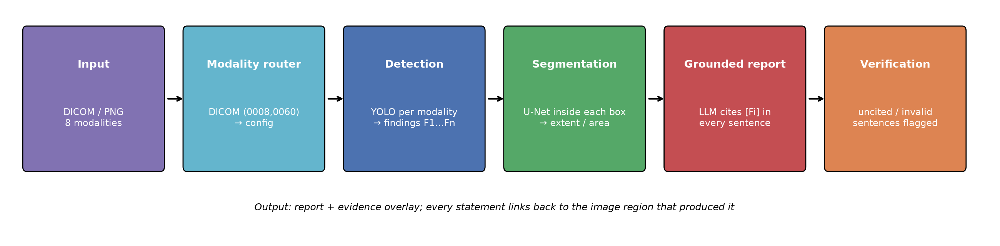

# AI Hospital

A modality-agnostic diagnostic platform: one pipeline handles **8 imaging modalities** (X-ray, CBCT, CT, MRI,
Ultrasound, PET-CT, mammography, angiography) and produces **grounded** reports, where every statement is
linked back to the image region that produced it, so clinicians can verify each claim.



## How grounding works
1. The detector turns the image into a numbered evidence list: `F1: nodule, 0.91, upper image-left chest …`.
2. The LLM (e.g. LLaMA 3 via Ollama) sees **only** that list and must end every sentence with its evidence ID(s).
3. Each generated sentence is parsed: citations must refer to real findings; uncited or invented statements are
   flagged ⚠️ instead of being silently accepted.
4. The evidence overlay draws each `Fi` on the image, so a reader can jump from sentence to region.

## Repository Structure
```
AI-Hospital/
├── Code/
│   ├── ai_hospital/
│   │   ├── modalities.py    # 8 modality configs, DICOM-code routing
│   │   ├── imaging.py       # DICOM/PNG loading, windowing, location description
│   │   ├── models.py        # YOLO detector + U-Net segmenter wrappers
│   │   ├── report.py        # grounded report generation + citation verification
│   │   ├── visualize.py     # evidence overlay
│   │   ├── schema.py        # Finding / Report data classes, markdown export
│   │   └── pipeline.py      # end-to-end DiagnosticPipeline
│   ├── run.py               # CLI
│   ├── plot_pipeline.py     # renders Figures/pipeline.png
│   ├── tests/               # grounding, routing and pipeline tests
│   ├── weights/             # model weights go here (see README)
│   └── requirements.txt
├── Dataset/                 # public datasets per modality
├── Figures/                 # pipeline diagram
├── Results/                 # generated reports and evidence overlays
├── LICENSE
└── README.md
```

## Quick Start
```bash
cd Code
pip install -r requirements.txt
python -m pytest tests                                   # grounding tests (no weights needed)
ollama pull llama3                                       # local LLM
python run.py --image study.dcm                          # modality read from the DICOM header
python run.py --image chest.png --modality xray --llm template
```

> Research software, not a medical device. Outputs must be reviewed by a qualified clinician.

## Author
**Wajiha Rahim Khan**  
[Google Scholar](https://scholar.google.com/citations?user=ctvOkbYAAAAJ)

## License
MIT. See [LICENSE](LICENSE).
